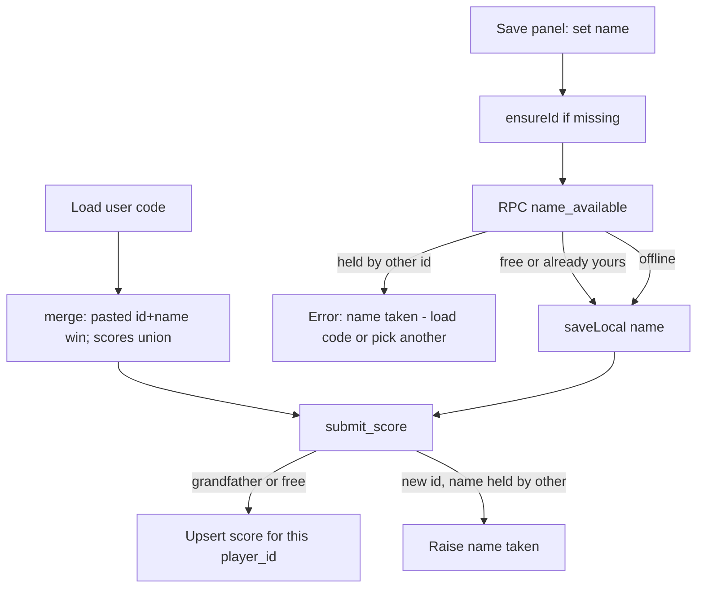

# Plan: Unique usernames without hijacking

- Created: 2026-11-08
- Status: draft
- Whole-suite verification: `npm test` (and hand-run updated [`db/schema.sql`](db/schema.sql) in Supabase before relying on production behavior)
- Decisions locked: **1A** (block at Save panel + `submit_score`); **2A** (forward-only — no duplicate-row cleanup); case-insensitive match; toilet on/off rows for the **same** `player_id` share one name; save-code import bypasses the “pick another name” path by becoming the owning id and merging local scores

## Goal

Stop new orphan leaderboard rows when someone types an existing username on a second device. Identity stays the secret save-code `id`; the display name becomes a claim held by at most one new `player_id`. Proving ownership = paste the signed user code (existing [`merge`](src/save.js) already unions scores and adopts the pasted id).

## How it works

**Ownership rule (DB):** a name key `lower(trim(name))` is blocked for `p_player_id` when **another** `player_id` already has a row with that key **and** this `player_id` does **not** already have a row with that key. That **grandfathers** today’s duplicate Alice rows so both can keep posting; a **third** id cannot join them; a brand-new device cannot mint a second Alice.

**Race:** `pg_advisory_xact_lock(hashtext(name_key))` at the start of the check+upsert in `submit_score` so two first-time claimants cannot both insert.

**Hijack:** claiming still requires posting as that `player_id`. The id only arrives via a valid HMAC save code (or local generation for a new player). Public reads still never expose `player_id`.

## Implementation

### 1. Schema — [`db/schema.sql`](db/schema.sql)

- Extend `submit_score`: after validation, lock on the name key; if another `player_id` holds `lower(name)` and this id has no row under that key → `raise exception 'name taken'`.
- Same-id rename to a free name: allowed (existing upsert overwrites `name` on that player’s rows; other players’ old duplicates are untouched — forward-only).
- Same-id rename to a name held only by others: blocked.
- Add `name_available(p_name text, p_player_id text) returns boolean` (`security definer`, same rule, no write). Grant `EXECUTE` to `anon`. Reload PostgREST (`notify pgrst`).
- Comment the grandfather rule and that existing duplicates are intentional leftovers.
- **Ops:** after merge, paste the whole file in the Supabase SQL editor (same as today). No GitHub-driven migrate.

### 2. Client leaderboard — [`src/leaderboard.js`](src/leaderboard.js)

- Add `checkNameAvailable(name, playerId, opts)` → `true` / `false` / `null` (null = unreachable / disabled), calling `/rpc/name_available`.
- Teach `request` (or a thin RPC helper) to surface PostgREST error messages on non-2xx so `submitScore` can distinguish `name taken` from other failures.
- Change `submitScore` to return `{ ok: boolean, reason?: 'nameTaken' | 'other' }` (update [`Play.syncLeaderboard`](src/scenes/Play.js) and tests). Still never throws; still never confirms the submit store on failure.

### 3. Save panel — [`src/ui/savePanel.js`](src/ui/savePanel.js)

- Make name persistence async: on blur/change/Save, `validateName` → `ensureId` → `checkNameAvailable`.
  - `false` → do **not** `saveLocal` the new name; status error pointing at Load user code / pick another name.
  - `true` → persist as today.
  - `null` (offline) → persist locally (scores stay device-local); optional soft note that the board may reject later. DB still enforces on sync.
- After successful **Load**, keep current merge UX; optionally run the same check and warn if the imported name is blocked for that id (squatter edge case) without undoing the merge.
- Disable Save briefly while the check is in flight to avoid double-submit races in the UI.

### 4. Copy — [`src/i18n.js`](src/i18n.js) + [`TRANSLATION_NOTES.md`](TRANSLATION_NOTES.md)

New keys (en + zh-Hans), e.g.:

- `saveNameTaken` — name is on the board under another device; copy the code from the device that already has it, Load it here, or choose a different username.
- `saveNameCheckFailed` — (optional) could not verify; username saved on this device only.

Light touch on `saveIntro` / `saveLeaderboardNote` only if needed so “one username ↔ one user code” is clear. No How-to rewrite unless a one-line username tip fits naturally.

### 5. Docs / version

- Short note in [`AGENTS.md`](AGENTS.md) (leaderboard / save section): names are unique per new `player_id` case-insensitively; import merges; grandfathered duplicates.
- Update [`.claude/plans/Flappy Poop — Save Code Spec.md`](.claude/plans/Flappy%20Poop%20—%20Save%20Code%20Spec.md) with the claim rule (display name vs id).
- Bump `VERSION` + [`src/changelog.js`](src/changelog.js) entry (product-visible).

### 6. Tests

- [`tests/leaderboard.test.js`](tests/leaderboard.test.js): `checkNameAvailable` true/false/null; `submitScore` `{ ok: true }`, `{ ok: false, reason: 'nameTaken' }` when body message contains `name taken`, other 400 → `other`.
- No Node run of Postgres; schema comments + hand-apply remain the contract (same as current toilet/level migrations).
- i18n key parity / notes coverage via existing suite.

## Out of scope

- Deleting or merging existing duplicate board rows.
- Display-time dedupe of the Top 25 by name.
- Password/email accounts; reclaim of a squatted name without the save code.

## Risk notes

- Until Supabase runs the new SQL, the client check 404s → treat as `null` (local save allowed); old `submit_score` will still accept duplicates. Ship client + remind to apply SQL the same day.
- Offline-first local save can still create a *local* taken name; the next online sync will fail to confirm — panel messaging + retry on game over / board open already exist; surface `nameTaken` in sync only if cheap (status toast is out of scope unless sync already has a hook).
