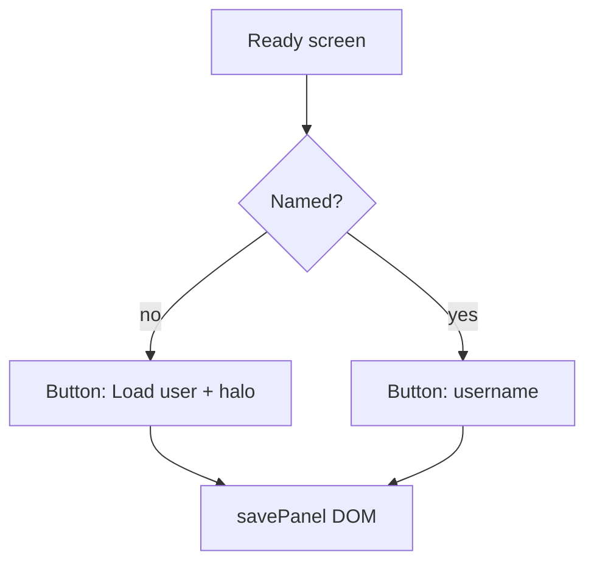

# Plan: Merge ready-screen user button; retire Scores

- Created: 2026-11-09
- Status: draft
- Baseline commit: `918b0e7` on `main` (clean)
- Whole-suite verification: `npm test` (baseline assumed green; re-run at step 1)
- Golden output: n/a

## Goal
One ready-screen button: **Load user** when unnamed (opens the save panel), the **username** when named (opens the same panel for rename/load/clear). Remove the local High scores overlay. Keep recording top scores in the save code for the global leaderboard.

## Approach (locked)
- Single layout box `profile` at the old lower slot (`y = 1067`); drop `saveLoad` so toilet/versus get breathing room above.
- Unnamed label: new i18n `loadUserButton` = "Load user" / 简体中文 equivalent; pulsing halo stays on this CTA.
- Named label: username only (no ` · best`); `profileLine` becomes name-only.
- Every tap opens `openSavePanel()`; unnamed also `{ focusName: true }` (no `closeOnSave`, so the code stays visible after Save).
- Delete [`src/scenes/Scores.js`](src/scenes/Scores.js) and all `scores` / `openScores` chrome wiring. Keep `scoresEmpty` (Leaderboard reuse). Keep `topScores` / save-code top lists.
- Bump `VERSION` → `0.8.5` with a CHANGELOG entry.

## Documents to update in the final step
- [`AGENTS.md`](AGENTS.md) — ready UI, Scores removal, scene list
- [`README.md`](README.md) — ready-screen / save-code steps
- [`TRANSLATION_NOTES.md`](TRANSLATION_NOTES.md) — key table
- Plan file under `.claude/plans/` (checkpointed workflow)

## Risks and notes
- Orphans / tools tests enforce overlay list parity with `main.js` and smoke `OVERLAYS` — update together.
- Versus layout tests pin saveLoad/profile y; update for one button.
- Do not stop recording scores in `save.js`; only retire the Scores UI.

## Steps

### Step 1/5 — Ready layout + button copy  [pending]
- Change: In [`src/logic.js`](src/logic.js) `readyLayout` / `readyHit`, remove `saveLoad`; keep one `profile` box at `1111 - boxH/2`. In [`src/i18n.js`](src/i18n.js): add `loadUserButton`, drop `saveLoadButton` / `profilePrompt` / `scoresTitle`; `profileButtonText` → name or `loadUserButton`; `profileLine` → name only; update `leaderboardJoin` / `leaderboardNameTaken` to say Load user. Update [`src/save.js`](src/save.js) `profileLine`. Adjust [`tests/ready.test.js`](tests/ready.test.js), [`tests/versus.test.js`](tests/versus.test.js), [`tests/i18n.test.js`](tests/i18n.test.js), [`tests/save.test.js`](tests/save.test.js), [`tests/field.test.js`](tests/field.test.js) if it asserts both boxes.
- Verify: `node --test tests/ready.test.js tests/i18n.test.js tests/save.test.js tests/versus.test.js tests/field.test.js`
- Commit: `feat(ready, step 1/5): one Load user / username button in readyLayout`

### Step 2/5 — Play wires the single button to the save panel  [pending]
- Change: [`src/scenes/Play.js`](src/scenes/Play.js) — remove `saveLoadBtn`; one `profileBtn` (+ halo when unnamed); tap `profile` → `openSavePanel` (focus name if unnamed); refresh text/halo/color; drop locale updates for `saveLoadButton`.
- Verify: `node --test tests/ready.test.js tests/i18n.test.js` (layout still matches Play’s single box)
- Commit: `feat(ready, step 2/5): profile tap always opens the save panel`

### Step 3/5 — Remove Scores overlay  [pending]
- Change: Delete [`src/scenes/Scores.js`](src/scenes/Scores.js). Strip Scores from [`src/main.js`](src/main.js), Play `chromeArgs` / `openScores` / `padTop`, [`src/logic.js`](src/logic.js) `chromeIntent` `scores` branch + typedefs. Update [`tests/chrome.test.js`](tests/chrome.test.js), [`tests/orphans.test.js`](tests/orphans.test.js), [`tests/tools.test.js`](tests/tools.test.js), [`tools/headless_check.mjs`](tools/headless_check.mjs) (drop `OVERLAYS.scores` and pad walk).
- Verify: `node --test tests/chrome.test.js tests/orphans.test.js tests/tools.test.js` && `npm test`
- Commit: `refactor(ui, step 3/5): retire the local High scores overlay`

### Step 4/5 — Version, changelog, orientation docs  [pending]
- Change: `VERSION` `0.8.5`; [`src/changelog.js`](src/changelog.js) notes (en + zh-Hans); update [`AGENTS.md`](AGENTS.md), [`README.md`](README.md), [`TRANSLATION_NOTES.md`](TRANSLATION_NOTES.md); write/update `.claude/plans/2026-11-09-merge-ready-user-button.md`.
- Verify: `npm test`; `grep` for `Save / Load User`, `Enter username`, `Scores.js`, `openScores`, `saveLoadButton`, `profilePrompt` finds only intentional leftovers (e.g. historical changelog).
- Commit: `docs(step 4/5): ready user button + Scores retirement in AGENTS/README; 0.8.5`

### Step 5/5 — Final checkpoint  [pending]
- Change: Mark plan complete; any leftover doc/plan hash updates.
- Verify: `npm test`; `git status` clean for plan files
- Commit: `chore(step 5/5): complete merge-ready-user-button plan`

## Completion summary
(filled after execution)