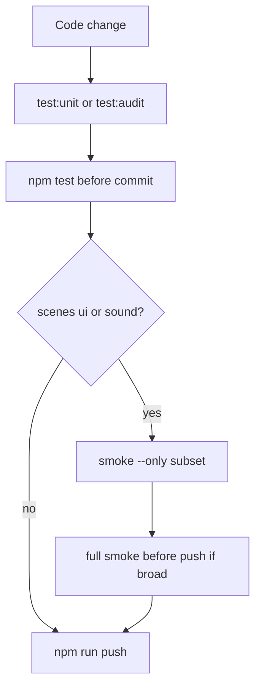

# Sustainable testing and audit workflow

## Goal
Make day-to-day verification faster and catch neglected code before it piles up, while keeping the existing gates (`npm test` before commit/push; full smoke after scene/UI work) and the **zero npm-deps** rule.

Out of scope: splitting [src/scenes/Play.js](src/scenes/Play.js), splitting mega unit files, ESLint/Knip, CI hosting. Implement on a **clean tree** after the in-progress coins plan ([.claude/plans/2026-11-08-coins-ready-check.md](.claude/plans/2026-11-08-coins-ready-check.md)) is finished or stashed—do not mix commits.

## Current baseline
- Unit: `node --test "tests/**/*.test.js"` — ~10s, ~376 tests; strong pure-logic + contract audits ([tests/assets.test.js](tests/assets.test.js), [tests/i18n.test.js](tests/i18n.test.js), [tests/scenes.test.js](tests/scenes.test.js), [tests/tools.test.js](tests/tools.test.js)).
- Smoke: one ~2k-line linear [tools/headless_check.mjs](tools/headless_check.mjs) (minutes); no `--only`; state is chained end-to-end.
- Gaps: no unused-export / sfx-load / TUNING-leaf audits; selective smoke impossible; when-to-run guidance is scattered.

## Locked design choices
- Stay **zero npm dependencies**; audits are Node `fs` + regex, same style as existing contract tests.
- Keep `npm test` = **full unit suite** (unchanged push gate in [tools/push.mjs](tools/push.mjs)).
- Smoke subsetting: named suites; each suite **self-seeds** when run alone; full smoke runs suites in one Chrome session in fixed order for speed.
- Intentional orphans get an **explicit allowlist** with a one-line reason (e.g. ToiletFlush until Boot loads it).

## Steps

### 1 — npm test tiers + when-to-run docs
- [package.json](package.json): keep `test`; add `test:audit` (html, assets, scenes, tools, serve, changelog, about, i18n, tuning, plus orphan file from step 2) and `test:unit` (the remaining `tests/*.test.js`).
- New section in [AGENTS.md](AGENTS.md) and a short pointer in [README.md](README.md): when to run `test:unit` / `test:audit` / `test` / `smoke -- --only=…` / full smoke / phone check; note selective `node --test path` already works.
- Verify: both tier scripts pass on a green tree; [tests/tools.test.js](tests/tools.test.js) asserts the two globs partition every `tests/*.test.js`.
- Commit: `chore(test, step 1/4): npm test tiers and when-to-run docs`

### 2 — Orphan / neglect audit suite
- Add [tests/orphan.test.js](tests/orphan.test.js) under `test:audit`:
  1. **Exports** — every export from `logic.js`, `versus.js`, `save.js`, `i18n.js`, `leaderboard.js`, `share.js`, `changelog.js`, `sound.js` is referenced under `src/`, `tests/`, or `tools/`.
  2. **Sfx triangle** — every `assets/sfx/` file is in CREDITS **and** in Boot `load.audio` (or allowlist); every load path exists. Closes credited-but-unloaded audio holes.
  3. **Texture keys** — every Boot image/spritesheet key appears as a string in `src/`.
  4. **i18n keys** — every catalog key is referenced from `src/` (small prefix allowlist for dynamic keys like levels).
  5. **TUNING leaves** — every leaf under TUNING / FIELD / LEADERBOARD / TEST_MODE is grepped in src + tests + smoke.
  6. **Scene wiring** — every overlay in `main.js` appears in Play chrome/pad routing (extends [tests/tools.test.js](tests/tools.test.js)).
- First green: allowlist known current orphans with reasons; do not delete product files unless clearly trash and untracked.
- Verify: `npm run test:audit` passes; a deliberate false-positive check proves the export scanner can fail.
- Commit: `test(audit, step 2/4): orphan contract suite for exports assets i18n tuning`

### 3 — Smoke suite registry and `--only` / `--list`
- Refactor [tools/headless_check.mjs](tools/headless_check.mjs) without changing check semantics:
  - Shared harness: Chrome, CDP, hermetic stubs, `bootReady()`, helpers.
  - Named suites in fixed full-run order: `boot`, `overlays`, `run`, `shop`, `mystery`, `share`, `pad`, `testmode`, `wide`, `versus` (mapped to existing comment blocks).
  - CLI: `npm run smoke` = all; `--list`; `--only=shop,mystery`; URL via positional or `--url=`.
  - With `--only`, fresh navigate + `bootReady` (and suite-local seed) before each selected suite.
  - Export `SUITES` for tools.test.js.
- If a suite cannot self-seed cleanly, mark it full-run-only in `--list` rather than shipping a lying subset.
- Verify: `--list` works; `--only=boot,overlays` passes with server up; full smoke still passes.
- Commit: `refactor(smoke, step 3/4): named suites with --only and --list`

### 4 — Docs closeout
- Finish AGENTS repo-map rows for new scripts/orphan suite; extend tools.test.js; write living plan at `.claude/plans/2026-11-08-test-audit-sustainability.md` during implementation; archive when complete.
- Verify: `npm test`; targeted smoke; docs name every new script; old `npm test` / `npm run smoke` still work.
- Commit: `docs(test, step 4/4): AGENTS test pyramid and archive plan`

## Risks
- Smoke extraction is the brittle step: preserve assertion text; prefer honest full-run-only over broken subsets.
- Export/TUNING scanners will false-positive on dynamic access; budget allowlists.
- Do not mix with the dirty coins WIP tree.
