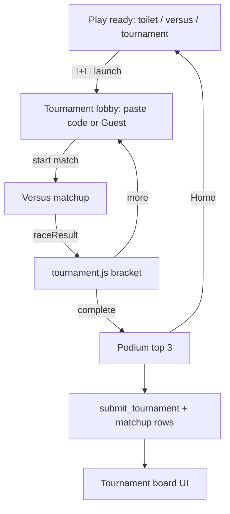

# Plan: Tournament mode (3–8 World Cup bracket + linked stats)

- Created: 2026-11-09
- Status: draft (handoff — do not start until in-progress plans finish and the tree is clean)
- Baseline commit: TBD on a clean `main` after current in-flight work lands (do not mix)
- Whole-suite verification: `npm test`; smoke: `npm run smoke` (tournament section)
- Golden output: n/a
- **Apply [`db/schema.sql`](db/schema.sql) in the Supabase SQL editor before shipping any client that calls the new RPCs** (same rule as today).

## Goal

Local **Tournament** (🏅) on one host device: 3–8 competitors, World Cup knockout, podium for top 3. Competitors can be **linked** (paste a user save code) or **guests** (temporary silly name). Linked players sync medals / best score / event counts to a **Tournament leaderboard**, and every linked-vs-linked race writes a **matchup row** for later head-to-head network analysis.

## Locked product decisions

- **Name / emoji:** Tournament / **🏅**. Leaderboard keeps **🏆**.
- **Entry:** 👥 on → **🏅** toggle under it; remeasure ready spacing (merged user button).
- **Players:** 3–8; random seed; byes to 4 or 8; bronze **before** Final when N≥4; N=3 Final only (semi loser = 3rd).
- **Race outcome:** higher score → fewer crashes → sudden-death mini-race (L7 motion, 25 pipes, no items; first to finish).
- **Architecture:** same-device sequential hot-seat via Versus (2 on screen). No realtime netplay.
- **Identity:**
  - **Linked:** someone creates/loads a username on their phone (existing save panel), sends the **user code** to the host; host pastes it into a tournament slot. Host runs `importCode` **in memory only** — extract `id` + `name`; **never** `saveLocal` / merge into the host’s own player.
  - **Guest:** no user code; host rolls a temporary name `AdjectiveNoun###` (### = 001–999). No save code, not written to Supabase, discarded when the tournament ends.
- **Trust:** pasting a user code shares that player’s secret id with the host (same trust as sharing a code for device sync). Document in How to / README.
- **Persistence:**
  - Guests: session-only.
  - Linked: at tournament end, host posts stats + matchup edges for every slot that has a `player_id`.
- **Highest tournament score (default):** lifetime **max of a player’s race scores** across linked tournament matchups (full bracket races; sudden-death finishes may count their pipe score too, or be excluded — prefer **include every scored Versus race in the tournament**, including sudden death if it awards points). Say so if you want “best Final only” instead.
- **Tournament board columns (per linked player):** display name; **(score)** highest tournament score; 🥇 gold count; 🥈 silver; 🥉 bronze; 🏎️ tournaments competed in.
- **Head-to-head:** store one row per race where **both** slots are linked; guests omitted from the edge table (still play, just no DB edge).

## Documents to update in the final step

- [AGENTS.md](AGENTS.md), [README.md](README.md), [db/schema.sql](db/schema.sql) header comments
- [src/logic.js](src/logic.js) `VERSION` + [src/changelog.js](src/changelog.js) (en + zh-Hans)
- [TRANSLATION_NOTES.md](TRANSLATION_NOTES.md), HowTo if needed
- Repo plan: `.claude/plans/2026-11-09-tournament-mode.md` (archive when complete)

## Risks and notes

- Ready spacing: ~101 px under 👥 after user-button merge; remeasure for 🏅 (see prior notes).
- Sudden death is a full mini Versus (25 pipes) — non-trivial Play flags.
- Schema must ship **before** the client that calls it; keep RPCs anon-safe (no table INSERT for anon; functions only; never expose other players’ `player_id` on SELECT).
- Guest names must fit **`NAME_MAX` 16** code points (`Adjective` + `Noun` + 3 digits) — keep dictionary words short; tests enforce `≤ 16`.
- Host holding pasted ids could submit as those players if RPCs only check id — mitigate with signed tournament payload or rate limits + “host tournament_id” auditing; v1 accepts share-code trust and rate-limits `submit_tournament`.
- Handoff: clean tree only.

## Architecture

### Bracket rules

| N | Size | Round 1 | Then |
|---:|---:|---|---|
| 3 | 4 | 1 match + 1 bye | Final only |
| 4 | 4 | 2 semis | bronze → Final |
| 5–7 | 8 | matches + byes | QF → SF → bronze → Final |
| 8 | 8 | 4 QF | SF → bronze → Final |

### Tie-break / sudden death

1. Higher score  
2. Fewer crashes  
3. Sudden death: L7, 25 pipes, moving pipes, **no items/power-ups/mystery/shop**; first to finish wins; re-run if still tied.

### Competitors (lobby slots)

Each slot: `{ displayName, playerId: string|null, guest: boolean }`.

- **Paste user code:** validate HMAC via `importCode`; on success set `playerId` + board/local `name` as `displayName`. Reject tampered / empty. Do not merge into host save.
- **Guest:** `rollGuestName(rng)` → `AdjectiveNoun###` from [`src/tournamentNames.js`](src/tournamentNames.js) (clean adjective list + silly toilet/poop/fart nouns; no swear/explicit words). Capitalize each word’s first letter; zero-pad ###. Reroll on collision within the lobby. `playerId = null`.

Phone flow for linked players: existing Load user → Copy code → host pastes into slot.

### Database (add to [`db/schema.sql`](db/schema.sql))

**`tournament_stats`** (one row per linked player):

- `player_id` PK (same id shape as scores)
- `name` (last known display name; renamed on submit like scores)
- `best_score` int (lifetime max race score)
- `gold` / `silver` / `bronze` int ≥ 0
- `events` int ≥ 0 (🏎️ tournaments competed)
- `updated_at`

**`tournament_matchups`** (append-only edges for network analysis):

- `id` bigserial
- `tournament_id` text (host-minted id for this event)
- `round` text (`qf` | `sf` | `bronze` | `final` | `sudden` | …)
- `player_a` / `player_b` text (canonical ids, ordered e.g. lexicographically for undirected uniqueness optional)
- `winner` text (must be a or b)
- `score_a` / `score_b` int
- `deaths_a` / `deaths_b` int optional
- `played_at` timestamptz

RLS: anon cannot SELECT `player_id` from matchups if that would leak secrets — either restrict matchup reads to **owner/service role only** (export via SQL for your analysis), or expose a redacted view. **v1: no anon SELECT on `tournament_matchups`** (owner-only analysis); anon may SELECT tournament board columns **without** `player_id` (name + stats), mirroring scores.

**RPCs (anon execute):**

- `submit_tournament(p_player_id, p_name, p_best_score, p_gold_delta, p_silver_delta, p_bronze_delta, p_events_delta)` — resolve aliases; upsert stats (max best_score; add medal/event deltas); name claim rules aligned with `submit_score` where practical.
- `record_tournament_matchup(...)` — insert one edge when both ids present; resolve aliases.
- `tournament_top(limit)` — board rows ordered by gold desc, then silver, bronze, best_score (tune in tests).

Client: [`src/tournamentBoard.js`](src/tournamentBoard.js) (Phaser-free, fake-fetch tests), patterned on [`src/leaderboard.js`](src/leaderboard.js).

### Tournament board UI

- Mode switch on the existing Leaderboard overlay (**🏆** classic scores ↔ **🏅** tournament), or a sibling entry — prefer **one overlay, two tabs** so tray stays one button.
- Row: name · (best) · 🥇n 🥈n 🥉n · 🏎️n

## Steps

### Step 1/10 — Pure tournament state machine  [pending]

- **Change:** [`src/tournament.js`](src/tournament.js) bracket API; slots carry optional `playerId`; match queue bronze→Final; `TUNING.tournament`. Tests: 3/4/5/8, byes, order.
- **Verify:** `node --test tests/tournament.test.js`
- **Commit:** `feat(tournament, step 1/10): pure World Cup bracket state for 3–8 players`

### Step 2/10 — raceResult + sudden-death knobs  [pending]

- **Change:** score → crashes → `suddenDeath`; `TUNING.tournament.suddenDeath` (25 pipes, L7, no items).
- **Verify:** `node --test tests/versus.test.js tests/tournament.test.js`
- **Commit:** `feat(tournament, step 2/10): raceResult score/crashes then sudden-death`

### Step 3/10 — Ready UI 🏅  [pending]

- **Change:** Remeasure layout; toggle; `TOURNAMENT_EMOJI = '🏅'`; launch stub Tournament scene.
- **Verify:** `node --test tests/ready.test.js tests/versus.test.js tests/i18n.test.js`
- **Commit:** `feat(tournament, step 3/10): 🏅 toggle under 👥`

### Step 4/10 — Guest names + user-code claim  [pending]

- **Change:** [`src/tournamentNames.js`](src/tournamentNames.js) dictionaries + `rollGuestName`; `claimSlotFromCode(code)` using `importCode` without persisting; tests for format, length ≤16, no banned stems, code claim extracts id/name.
- **Verify:** `node --test tests/tournamentNames.test.js tests/tournament.test.js`
- **Commit:** `feat(tournament, step 4/10): guest names and in-memory user-code claims`

### Step 5/10 — Lobby UI  [pending]

- **Change:** Tournament lobby: N stepper, per-slot Paste code / Guest / clear, bracket graphic, Start / Home. DOM paste field (savePanel pattern).
- **Verify:** `npm test`; smoke stub open lobby.
- **Commit:** `feat(tournament, step 5/10): Tournament lobby with paste and guest slots`

### Step 6/10 — Versus host + sudden death + in-memory matchups  [pending]

- **Change:** Versus tournament path; sudden-death mini-race; accumulate `{ matchups[], placings, bestScoresBySlot }` on the Tournament scene for end sync. Rematch off; Home abandons (no submit).
- **Verify:** `npm test`
- **Commit:** `feat(tournament, step 6/10): Versus hosted by tournament with sudden death`

### Step 7/10 — Schema + client API  [pending]

- **Change:** Extend [`db/schema.sql`](db/schema.sql); [`src/tournamentBoard.js`](src/tournamentBoard.js) + [`tests/tournamentBoard.test.js`](tests/tournamentBoard.test.js) with fake fetch. Document apply-before-push.
- **Verify:** `node --test tests/tournamentBoard.test.js`; schema reviewed for anon grants.
- **Commit:** `feat(tournament, step 7/10): tournament_stats matchups RPCs and client`
- **Rollback note:** DB changes are not undone by git; keep functions additive/idempotent.

### Step 8/10 — Podium, sync, board UI  [pending]

- **Change:** Podium; on Home/Continue after complete, `submit_tournament` per linked placer (medal deltas + events + best_score) and `record_tournament_matchup` for each linked-vs-linked race. Leaderboard overlay 🏅 tab. Guests shown on podium but skipped in sync.
- **Verify:** `npm test`; manual or stubbed sync path.
- **Commit:** `feat(tournament, step 8/10): podium sync and tournament board tab`

### Step 9/10 — Smoke + registration  [pending]

- **Change:** headless tournament section; orphans/tools/scenes; muzzle network like leaderboard tests.
- **Verify:** `npm test`; `npm run smoke -- --only=tournament` (or wired section).
- **Commit:** `test(tournament, step 9/10): smoke and registration`

### Step 10/10 — Docs + version  [pending]

- **Change:** VERSION, CHANGELOG, AGENTS, README (paste code / guest / board / trust note), schema header; archive plan.
- **Verify:** `npm test`; grep 🏅 vs 🏆.
- **Commit:** `docs(tournament, step 10/10): document Tournament mode and bump version`

## Completion summary (filled on finish)

`git log --oneline <baseline>..HEAD`; confirm schema applied in Supabase; note that matchup graph analysis is owner-SQL later (not in-game).
