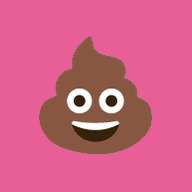
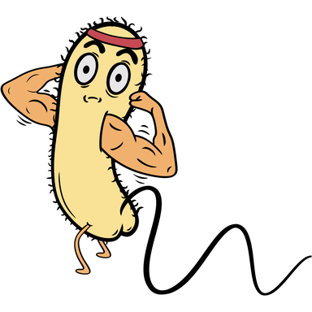
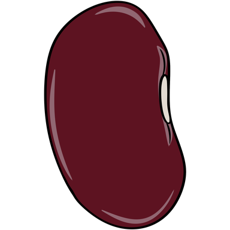
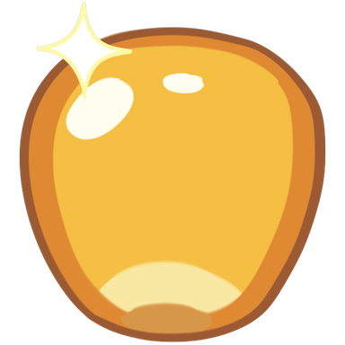

# Flappy Poop

<p align="center">
  
</p>

A Flappy Bird–style game for phone browsers: flap a poop through the gut, dodge pink intestinal folds, grab fiber and beans, and try to make it out the other end.

**Play now → [sielerjm.github.io/flappy-poop](https://sielerjm.github.io/flappy-poop/)**

Works best on your phone — add it to your home screen for a full-screen, app-like launch. On a desktop or landscape window the gut widens to fill the screen. English and Simplified Chinese in-game. Version **0.13.0 beta**.

Tip: on iPhone, turn **Silent mode off** to hear sound.

| | |
| --- | --- |
| [👆 How to play](#how-to-play) | [🥦 Pickups & power-ups](#pickups--power-ups) |
| [🏁 Levels & shop](#levels--shop) | [🎮 Controls](#controls) |
| [👥 Two players](#two-players) | [🌞 Daily Dump](#daily-dump) |
| [🏆 Save codes & leaderboard](#save-codes--leaderboard) | [🛠️ For developers](#for-developers) |


## 👆 How to play

- **Tap** (or press **Space** / **↑**) to flap.
- Fly through gaps in the pink pipe pairs — each pair you pass is **+1**.
- Hit a pipe, the ceiling, or the floor and the run ends.
- Each gut segment ends at a **checkered finish line**. Cross it for a short break, then keep going.
- Level 7 (the rectum) is the last: clear it and you win — **YOU MADE IT OUT!**
- After a crash: **Play again** starts the next run at once, **Home** goes back to the home screen, and **Share** sends a picture of your run with the game's link. Beat your best and the panel says so.

Open the round **?** on the ready screen anytime for the in-game guide (pickups, levels, controls, toilet mode, two players, tournament, and what each tray button does). Tap the version number at the bottom of any panel for **What’s new**.


## 🥦 Pickups & power-ups

From early in a run, helpful (and not-so-helpful) things appear between the pipes.

### Fiber, probiotic, postbiotic, bacteria

| | What it does |
| --- | --- |
|  **Fiber** (broccoli) | **+3** score |
|  **Probiotic** | Blocks **one** bad-bacteria hit for the next **5** pipes |
|  **Postbiotic** | Eat fiber while a probiotic is up: pipes and fiber score **×2** until the probiotic runs out (farts included; kernels count double too). Another probiotic extends it; a bacteria hit still blocks but ends the ×2 |
|  **Bacteria** | **−3** score (never below 0). Does **not** kill. Never in level 1; from level 2, pair 5 on |

A probiotic does **not** save you from a pipe.

###  Beans & fart

- Grab a **bean** between pipe pairs (from level 2). Beans stack up to **3**.
- When charged, the poop shows stink lines and a soft glow — tap the poop, the bean button, or press **B** to **fart**.
- A normal fart spends **one** bean: the world surges so **five** pipes rush past (~2.5 s). You cannot die while farting.
- With **three** beans, the glow turns rainbow: a **super fart** spends all three and rockets you past **twenty** pipes.

###  Mystery box

A spinning brown box with a question mark. The first is guaranteed early in **level 3**; after that they show up about half as often as fiber.

Open one for a random reward — usually fiber, or a probiotic, beans, coins, a ready-made postbiotic, or (rarely) a skip to the end of the level. Details below under [Odds & details](#odds--details).

###  Coins (golden corn kernels)

- Spend them in the **shop** at each level break.
- **One kernel is guaranteed per level**; extras can appear from level 2, and boxes can pay coins too.
- Every finish line pays coins equal to the **level number** (and in two-player, **+3** more if you didn’t crash that level).
- Coins last **one run only** — a new game starts at 0; a single-player death clears the purse.


## 🏁 Levels & shop

### 🏁 Levels

The gut is cut into seven segments (stomach → rectum). You advance by **pipe pairs passed**, not by score.

| Level | Pairs in level | Ends at pair |
| --- | ---: | ---: |
| 1 Stomach | 10 | 10 |
| 2 Duodenum | 25 | 35 |
| 3–7 | 50 each | 85 … 285 |

- **Level 1** is a scripted intro: probiotic at pair 3, fiber after pairs 4 and 7, a bean after pair 9 — no bad bacteria, no random rolls.
- From **level 4**, some pipe pairs (a lighter pink) move up and down, faster with every level, resting for a moment at the top and bottom of each swing.
- A fart never carries you past a finish line: if the line is closer than the burst, the fart ends at the line and the break starts.

### 💰 The shop

At every level break, tap **💰** under the banner (dimmed when empty).

| Item | Cost |
| --- | ---: |
|  Fiber | 1 |
|  Mystery box | 5 |
|  One bean | 6 |
|  Super fart (fill bag to 3) | 16 |

A bought mystery box spins a little slot machine before the reward lands. Close the shop with ✕, a tap outside, Esc, or your fart button — closing never starts the next level.

### Odds & details

Mystery-box draws (fiber takes the leftover ~33%):

| Reward | Chance |
| --- | ---: |
|  Probiotic | 20% |
|  One bean | 20% |
|  5 coins | 10% |
|  Postbiotic (5 pipes, ×2 on) | 5% |
|  Three beans | 5% |
|  10 coins | 5% |
| 🏁 Skip to finish | 1% |
|  15 coins | 1% |

A bean draw with a full bag, or a skip once the finish line is already out, becomes fiber instead.


## 🎮 Controls

### Ready screen

Along the top: the **🌞** (the [Daily Dump](#daily-dump)) and the **?** (How to play). Then, top to bottom: title, bobbing poop (“TAP TO FLAP!”), **toilet toggle**, and your **user button**: `Load user` until you set a name, then `name · best`; it opens Save / Load.

### During a run

| Input | Action |
| --- | --- |
| Tap / Space / ↑ | Flap (first tap also starts) |
| **B** / bean button / tap poop | Fire fart when charged; in a level break, open/close the shop |
| **P** / Esc / ⏸ | Pause / resume |
| **M** | Mute / unmute |
| **S** | Settings |
| **I** | About |
| **L** | Language |
| **F** | Feedback |
| **T** | Leaderboard |

### Tray

- **Bottom-left:** About (i), language (🌐), feedback (💬)
- **Bottom-right:** Leaderboard (🏆), mute, settings, with pause above the cog

### 🚽 Toilet mode

Flip the toilet toggle when you’re playing on the toilet. Those runs show a 🚽 beside the score and on the leaderboard. Off by default each launch.

### Controller

Xbox-style pads work in desktop browsers and iPhone Safari (press any button once so the browser sees the pad).

| Button | Action |
| --- | --- |
| **A** | Flap / confirm |
| **RT** | Fart / shop toggle in a break |
| **Menu** | Pause |
| **B** | Back / close overlay |
| **Y** | Mute |
| D-pad / stick | Move the pink focus ring |

The ring only appears after a pad press; a tap or click hides it again.


## 👥 Two players

On a window wide and tall enough for two phone-width halves (desktop or tablet landscape — not a phone in portrait), a **👥** toggle appears under the toilet switch.

1. Turn it on and tap to start → the **tournament lobby** (every two-player session is a [tournament](#-tournament); two guests are filled in, so **Start**, then **Play**, is all a quick race needs).
2. On the race's **join screen** (left player left, right player right), claim a half: tap your side, use a keyboard group, or a controller. Keyboard groups: **W / Space + E / Left Shift** vs **↑ / Enter + Right Shift / Numpad 0**.
3. After both claim, a **3-2-1-GO** starts the race (toilet flush on GO). A flap right on GO can give a short head start.

**Same course, separate luck.** Both players see the same pipes and pickups; what a mystery box *gives* is each player’s own roll. The other poop appears as a faded **ghost** nearby, and as a marker on your progress bar.

**Levels stay in sync.** Cross the finish line and wait for the other player; both must tap **ready** before the next countdown. An open shop holds the start.

**Crashes don’t end the match.** You tumble, lose **2 × level** points and **10%** of your coins (keep 90%, rounded down), clear power-ups, then respawn with a clear screen.

**Scoring.** First over each finish line gets **+25** (second gets none). Both still get the level’s coins. When both clear the rectum, higher score wins; ties go to fewer crashes, then more finish lines crossed first, then whoever crossed the last line first. Trailing players get friendlier mystery draws. Races are never saved to the 🏆 leaderboard.

### 🏅 Tournament

2–8 players on one device, two at a time, in a knockout bracket. The 👥 start opens the lobby (the **?** in its corner explains the rules; **✕** goes back to single player). A controller works throughout: the d-pad moves a gold ring, **A** presses, **B** closes the lobby, the help card or the bracket you opened mid-race.

1. Set the number of players (new rows start as guests), then fill each row: **Paste code** (that player's user code: their username comes along), **Guest** (a made-up name like *JollyPlunger042*), or **Use my player** (yours).
2. **Start** draws the bracket: quarter-finals (from 5 players), semi-finals, a **bronze match**, then the **Final**. Byes fill the gaps; with 3 players, one semi and the Final, and the semi loser takes bronze; with 2, just the Final.
3. Until the first race, **choose who meets whom**: drag a player by its ⠿ handle, use **↑ ↓**, or **🎲 Shuffle**.
4. **Play** each match: the two named players claim their halves as usual. Races are shorter than a normal run (levels of 10 / 25 / 35 / 35 / 35 / 35 / 50 pairs). Ties go to fewer crashes, then more finish lines crossed first, then whoever crossed the last line first. When both players wait at a finish line, **🏅 Bracket** shows the draw.
5. After a race, **Continue** goes straight to the next one (the Final ends on a 🥇 🥈 🥉 podium); **Bracket** shows the bracket first. Both record the race. **Abandon** (two taps) stops early and goes back to the lobby with the same players.

**Medals.** When the Final of a tournament of 3 or more is decided, everyone who joined with their user code (and you, with **Use my player**) gets their medals on the **🏅 medal board**: tap 🏆, then the 🏅 tab under the title. Players rank by 🥇, then 🥈, 🥉 and their best race. Offline, the podium keeps the medals on this device and posts them next time the board can be reached. Guests, two-player tournaments and abandoned tournaments are never saved.

A pasted code shares that player's secret save id with the host device for the tournament (it is never stored); paste codes only from people you're playing with. The server checks every bracket it receives, but a host holding everyone's codes could still report races that never happened: the medal board is for friends, not prizes.


## 🌞 Daily Dump

One try a day, the same course for everyone, Wordle style. Tap the **🌞** at the top of the home screen (it glows until you have played today):

- **Create user** first if you have no username: your score goes on the board under it. Then **Play**.
- The course comes from the date (UTC), so everyone flies the same pipes and pickups; a box gives everyone the same thing too. It runs at one level all day (3–7, shown in the popup) and **never ends**: no finish lines, no breaks, no kernels or shop. Go as far as you can.
- One crash and the day is done. Quitting or reloading mid-run counts as your try (the score so far is kept). It is one try per player, not per device: before offering **Play**, the game checks the 🌞 board for your user code, so a second phone or browser shows your result instead. (Offline it cannot check, but only your first score of the day ever counts.)
- The result shows your rank for the day (tap your score for the **🌞 board**), a countdown to the next course and **Share**. A new course starts every day at **00:00 UTC** (01:00 in Geneva, late afternoon in the US).
- Daily scores have their own board and never touch the 🏆 Top 25. Offline, the score posts the next time the board can be reached.

The 🌞 board, like the others, is for friends, not prizes: the course comes from your device's clock (someone could set it ahead and practise tomorrow's), scores are reported by the game, and the server keeps only the first score it gets from you each day. If you ran a fart, the pair right after it opens mid-height for you, so two players' courses can differ by a pipe or two.


## 🏆 Save codes & leaderboard

### Username & save code

1. Tap **Load user** (or your name, once set) on the ready screen.
2. Pick a username and press **Save** — it appears on the public leaderboard with your best. A new username has 4–16 characters (at least 2 in Chinese, Japanese or Korean), no spaces or emoji, and no rude words; names chosen before these rules keep working. (The game checks this, not the server.)
3. **Copy** your `fp1.…` user code and keep it somewhere safe.
4. On another phone or browser, **Load** that code to bring your name and best 6 scores with you.
5. To change your username, type a new one and press **Save**: every phone and browser that uses your code picks up the new name on its own.

A username belongs to one player on the board: if a name is taken, paste your code instead (or pick another name). **Clear** (two taps) signs this device out only — the board keeps your rows; the code brings them back.

### Leaderboard

The 🏆 tray button (or **T**) shows a shared **Top 25**. You need a username to appear. Toilet runs keep their 🚽. Offline, the board says it can’t be reached and posts your best next time it can. The tabs under the title switch to the **🌞 Daily Dump** board for today and the **🏅 medal board** from tournaments.


## 🛠️ For developers

Plain ES modules, no bundler, no runtime npm dependencies. [Phaser 4.2.1](https://phaser.io) from a CDN, deployed to GitHub Pages from `main`.

### Run locally

```bash
npm start      # serves on 0.0.0.0:8000 and prints laptop + phone URLs
npm install    # once: PGlite, the only devDependency (runs db/schema.sql in the tests)
npm test       # Node 22 built-in test runner
npm run smoke  # with npm start running: drive the real game in headless Chrome
npm run smoke -- --list           # named smoke sections
npm run smoke -- --only=wide,pad  # subset while iterating
npm run push   # stamp About "Updated" time, test, commit the stamp, push main
```

`npm start` prints `http://localhost:8000` for the laptop and `http://<LAN-IP>:8000` for a phone on the same Wi-Fi. Do not open localhost on the phone — that is the phone itself.

### Host your own

Fork or push this repo to GitHub, enable Pages (Settings → Pages → Deploy from branch → `main` / root), then open `https://<you>.github.io/<repo>/`.

### Art, tuning, layout

- Art contract and sizes: [`assets/README.md`](assets/README.md). Player/item redraws go through `assets/src/` + `tools/process_art.py`.
- Feel numbers live in `TUNING` in [`src/config.js`](src/config.js) — change a number, reload.
- Full repo map and agent rules: [`AGENTS.md`](AGENTS.md).

### Leaderboard (self-host)

The board is a free-tier [Supabase](https://supabase.com) project. The browser talks to the REST API with the public URL and publishable key in `LEADERBOARD` in [`src/config.js`](src/config.js). Safety comes from [`db/schema.sql`](db/schema.sql): the key can read name / score / toilet / level / time (not ids) and write only through its functions (`submit_score()`, `merge_players()`, `submit_tournament()`, `submit_daily_score()`); the 🏅 and 🌞 boards are read through `tournament_board()` and `daily_board()`, which never return ids.

To run your own: create a free Supabase project, run `db/schema.sql` in the SQL editor, then put the Data API URL and publishable key into `LEADERBOARD`. Leave either blank to turn the feature off.

What leaves the phone: username, best scores with level, Daily Dump scores (day, level, pipes), finished tournaments' results, and the random id inside your save code. The save code itself never leaves the device.

### Credits & lineage

- Credits and sound attribution: [`CREDITS.md`](CREDITS.md)
- Translation notes: [`TRANSLATION_NOTES.md`](TRANSLATION_NOTES.md)
- Phaser is pinned in `index.html` to `phaser@4.2.1` from jsDelivr
- Rewritten from scratch, replacing the older joke version at [sielerjm/flappy-poop](https://github.com/sielerjm/flappy-poop)
