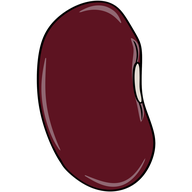

# Flappy Poop

<p align="center">
  
</p>

A Flappy Bird–style game for phone browsers: flap a poop through the gut, dodge pink intestinal folds, grab fiber and beans, and try to make it out the other end.

**Play now → [sielerjm.github.io/flappy-poop](https://sielerjm.github.io/flappy-poop/)**

Works best on your phone — add it to your home screen for a full-screen, app-like launch. On a desktop or landscape window the gut widens to fill the screen. English and Simplified Chinese in-game. Version **0.24.0 beta**.

Tip: on iPhone, turn **Silent mode off** to hear sound.

| | |
| --- | --- |
| [👆 How to play](#how-to-play) | [🥦 Pickups & power-ups](#pickups--power-ups) |
| [🏁 Levels & shop](#levels--shop) | [🎮 Controls](#controls) |
| [👥 Two players](#two-players) | [🌞 Daily Dump](#daily-dump) |
| [🏆 Save codes & leaderboard](#save-codes--leaderboard) | [🎅 December](#december) |
| [🛠️ For developers](#for-developers) | |


## 👆 How to play

- While the game loads, swipe (or use **‹ ›**, **← →** or a controller's d-pad) through tips and new features, then press **Continue**.
- **Tap** (or press **Space** / **↑**) to flap.
- Fly through gaps in the pink pipe pairs — each pair you pass is **+1**.
- Hit a pipe, the ceiling, or the floor and the run ends.
- Each gut segment ends at a **checkered finish line**. Cross it for a short break, then keep going.
- Level 7 (the rectum) is the last: clear it and you win — **YOU MADE IT OUT!**
- After a crash: **Play again** starts the next run at once, **Home** goes back to the home screen, and **Share** sends a picture of your run with the game's link. Beat your best and the panel says so.

Open the round **?** on the ready screen anytime for the in-game guide (pickups, levels, controls, toilet mode, two players, tournament, and what each tray button does). Tap the version number at the bottom of any panel for **What’s new**.


## 🥦 Pickups & power-ups

From early in a run, helpful (and not-so-helpful) things appear between the pipes.

### Fiber, probiotic, postbiotic, bacteria

| | What it does |
| --- | --- |
|  **Fiber** (broccoli) | **+3** score |
|  **Probiotic** | Blocks **one** bad-bacteria hit for the next **5** pipes |
|  **Postbiotic** | Eat fiber while a probiotic is up: pipes and fiber score **×2** until the probiotic runs out (farts included; kernels count double too). Another probiotic extends it; a bacteria hit still blocks but ends the ×2 |
|  **Bacteria** | **−3** score (never below 0). Does **not** kill. Never in level 1; from level 2, pair 5 on |

A probiotic does **not** save you from a pipe.

###  Beans & fart

- Grab a **bean** between pipe pairs (from level 2). Beans stack up to **3**.
- When charged, the poop shows stink lines and a soft glow — tap the poop, the bean button, or press **B** to **fart**.
- A normal fart spends **one** bean: the world surges so **five** pipes rush past (~2.5 s). You cannot die while farting.
- With **three** beans, the glow turns rainbow: a **super fart** spends all three and rockets you past **twenty** pipes.

###  Mystery box

A spinning brown box with a question mark. The first is guaranteed early in **level 3**; after that they show up about half as often as fiber.

Open one for a random reward — usually fiber, or a probiotic, beans, coins or a ready-made postbiotic. Details below under [Odds & details](#odds--details).

###  Coins (golden corn kernels)

- Spend them in the **shop** at each level break.
- **One kernel is guaranteed per level**; extras can appear from level 2, and boxes can pay coins too.
- Every finish line pays coins equal to the **level number** (and in two-player, **+3** more if you didn’t crash that level).
- Coins last **one run only** — a new game starts at 0; a single-player death clears the purse.


## 🏁 Levels & shop

### 🏁 Levels

The gut is cut into seven segments (stomach → rectum). You advance by **pipe pairs passed**, not by score.

| Level | Pairs in level | Ends at pair |
| --- | ---: | ---: |
| 1 Stomach | 10 | 10 |
| 2 Duodenum | 25 | 35 |
| 3–7 | 50 each | 85 … 285 |

- **Level 1** is a scripted intro: probiotic at pair 3, fiber after pairs 4 and 7, a bean after pair 9 — no bad bacteria, no random rolls.
- From **level 4**, some pipe pairs (a lighter pink) move up and down, faster with every level, resting for a moment at the top and bottom of each swing.
- A fart never carries you past a finish line: if the line is closer than the burst, the fart ends at the line and the break starts.

### 💰 The shop

At every level break, tap the **kernel button** under the banner (it shows your coins; dimmed when empty).

| Item | Cost |
| --- | ---: |
|  Fiber | 1 |
|  Mystery box | 5 |
|  One bean | 6 |
|  Super fart (fill bag to 3) | 16 |

A bought mystery box spins a little slot machine before the reward lands. Close the shop with ✕, a tap outside, Esc, or your fart button — closing never starts the next level.

### Odds & details

Mystery-box draws (fiber takes the leftover ~34%):

| Reward | Chance |
| --- | ---: |
|  Probiotic | 20% |
|  One bean | 20% |
|  5 coins | 10% |
|  Postbiotic (5 pipes, ×2 on) | 5% |
|  Three beans | 5% |
|  10 coins | 5% |
|  15 coins | 1% |

A bean draw with a full bag becomes fiber instead.


## 🎮 Controls

### Ready screen

Along the top: the **🌞** (the [Daily Dump](#daily-dump)) and the **?** (How to play). A small orange number on the 🌞 is your Daily Dump streak, the days in a row you have played it (on the 📚 switch, your learning streak); the 🌞 card and the 📚's “Your cards” say it too: “🔥 Current streak = 3”. Then, top to bottom: title, bobbing poop (“TAP TO FLAP!”), **toilet toggle**, and your **user button**: `Sign in` until you set a name, then `name · best`; it opens your player panel.

### During a run

| Input | Action |
| --- | --- |
| Tap / Space / ↑ | Flap (first tap also starts) |
| **B** / bean button / tap poop | Fire fart when charged; in a level break, open/close the shop |
| **P** / Esc / ⏸ | Pause / resume |
| **M** | Mute / unmute |
| **S** | Settings |
| **I** | About |
| **L** | Language |
| **F** | Feedback |
| **T** | Leaderboard |
| **←** / **→** | Leaderboard: the page before / after |

### Tray

- **Bottom-left:** About (i), language (🌐), feedback (💬)
- **Bottom-right:** Leaderboard (🏆), mute, settings, with pause above the cog

### 🚽 Toilet mode

Flip the toilet toggle when you’re playing on the toilet. Those runs show a 🚽 beside the score and on the leaderboard. Off by default each launch.

### Controller

Xbox-style pads work in desktop browsers and iPhone Safari (press any button once so the browser sees the pad).

| Button | Action |
| --- | --- |
| **A** | Flap / confirm |
| **RT** | Fart / shop toggle in a break |
| **Menu** | Pause |
| **B** | Back / close overlay |
| **Y** | Mute |
| D-pad / stick | Move the pink focus ring |

The ring only appears after a pad press; a tap or click hides it again.


## 👥 Two players

A **👥** toggle sits under the toilet switch on every screen. On a window wide and tall enough for two phone-width halves (desktop or tablet landscape), it starts a race on this screen; on a smaller one, such as a phone, tapping Play opens the **🌐 online** window instead (see 🌐 Online race below).

1. Turn it on and tap to start → the **tournament lobby** (every two-player session is a [tournament](#-tournament); two players are filled in, you first if you have a username, so **Start**, then **Play**, is all a quick race needs).
2. On the race's **join screen** (left player left, right player right), claim a half: tap your side, use a keyboard group, or a controller. Keyboard groups: **W / Space + E / Left Shift** vs **↑ / Enter + Right Shift / Numpad 0**.
3. After both claim, a **3-2-1-GO** starts the race (toilet flush on GO). A flap right on GO can give a short head start.

**Same course, separate luck.** Both players see the same pipes and pickups; what a mystery box *gives* is each player’s own roll. The other poop appears as a faded **ghost** nearby, and as a marker on your progress bar.

**Levels stay in sync.** Cross the finish line and wait for the other player; both must tap **ready** before the next countdown. An open shop holds the start.

**Crashes don’t end the match.** You tumble, lose **2 × level** points and **10%** of your coins (keep 90%, rounded down), clear power-ups, then respawn with a clear screen.

**Scoring.** First over each finish line gets **+25** (second gets none). Both still get the level’s coins. When both clear the rectum, higher score wins; ties go to fewer crashes, then more finish lines crossed first, then whoever crossed the last line first. Trailing players get friendlier mystery draws. Races are never saved to the 🏆 leaderboard.

### 🌐 Online race

Two players on two devices, by code (0.25.0; pause, rejoin, friends and invites 0.28.0). With 👥 on, Play opens the tournament window; its **🌐** switch picks online (on a phone it is always on). You need a username: pick one there if you have none.

1. One player taps **Create room** and reads out the six-digit code (it lasts 15 minutes; a fresh one comes by itself). The other taps **Join with code** and types it on the game's keypad. A device can type 5 wrong codes and join 10 rooms in 10 minutes (devices on one network share a larger limit); after that it waits a few minutes.
2. The host sees "<name> wants to race" and taps **Let in** (or **Decline**, which makes a new code). Both tap **Ready**, and the 3-2-1 starts on both screens at once.
3. The race uses the two-player rules above. The other player is the ghost, with their name and live score in a pill at the top. Both play on the narrower of the two screens.
4. At each finish line both tap ready again. If the other player takes a while (45 s), you can **Keep waiting** or **Leave**. At the end, **Rematch** (when both ask) races a new course; **Leave** goes back to single player. A host can start a new race one minute after their last one began, in the same room or a new one. In an online race, holding a key down counts as one tap.

**⏸ Pauses are shared.** If either connection drops, either player hides the app or goes offline, or either presses pause or opens a menu, both games pause. Both tap **Ready** and a 3-2-1 resumes them. **Leave** on the pause screen (tap twice) ends the race with no winner. The screen stays on during a race.

**Reload or relaunch.** Reloading, or reopening the home-screen app or the tab mid-race, rejoins it. Both players go back to the start of the level they were on, with the score, coins and powers they had there, and tap **Ready**. A second window of the game does not take the race over ("Your race is running in another window."). A reload after your own finish does not rejoin.

**📱 Devices.** Your first device online is trusted. Another device of the same player (after you sign in with your code) waits until you type the 6-digit pairing code that a trusted device shows. While it waits it races by code and its races are saved like any other; 🤝 Friends, 🏁 Recent races and 📱 Devices open only once it is paired. A device can switch to a different player online up to 10 times an hour. **🏁 Recent races** lists your last online races, private to you and shown only on a paired device. A race is saved when both devices report the same result: the winner earns gold and the loser silver on the 🏅 board, and both scores reach the 🏆 board, up to a daily limit (10 counted races a day per pair of players, 20 per player). A race shorter than 3 minutes is not saved, and neither is one left half-way.

**🤝 Friends.** The online home has a **🤝 Friends** button. A friend is added only from a saved race together, played on two paired devices: tap **Add as a friend** on the results panel, or **Add friend** in an opponent's ⋯ under Recent opponents. There is no search, so nobody can look you up. The other player gets a request to **Accept** or **Decline**; you can take back one you sent. Each friend shows a dot and a word: 🟢 Online (in 🌐), 🟡 In a game, ⚪ Offline. The ⋯ on a row removes a friend or blocks a player (both ask twice). Blocking ends any friendship, stops their requests, and takes your races out of each other's lists; you can unblock from the Blocked list. You can send up to 20 requests a day, and 3 to the same player in a week.

**✉️ Invites.** In 🌐 online mode, a friend who shows 🟢 Online has an **Invite** button. The friend sees a ✉️ with a ring that runs down over 2 minutes; one tap joins your room, and **✕** turns it down. You see "Waiting for <name>", and **Resend** after a no or when the time runs out. Waiting invites show as a ✉️ count on 🤝 Friends. Invites work only while both of you are in 🌐 online mode. You can send 5 a minute, 10 an hour to one friend and 100 a day. **Share** on a room's code screen sends a link that joins the room; a link to a closed room says it has expired.

### 🏅 Tournament

2–8 players on one device, two at a time, in a knockout bracket. The 👥 start opens the lobby (the **?** in its corner explains the rules; **✕** goes back to single player). A controller works throughout: the d-pad moves a gold ring, **A** presses, **B** closes the lobby, the help card or the bracket you opened mid-race.

1. Set the number of players (new rows start as guests), then fill each row: **Paste code** (that player's user code: their username comes along), **Guest** (a made-up name like *JollyPlunger042*), or **Use my player** (yours).
2. **Start** draws the bracket: quarter-finals (from 5 players), semi-finals, a **bronze match**, then the **Final**. Byes fill the gaps; with 3 players, one semi and the Final, and the semi loser takes bronze; with 2, just the Final.
3. Until the first race, **choose who meets whom**: drag a player by its ⠿ handle, use **↑ ↓**, or **🎲 Shuffle**.
4. **Play** each match: the two named players claim their halves as usual. Races are shorter than a normal run (levels of 10 / 25 / 35 / 35 / 35 / 35 / 50 pairs). Ties go to fewer crashes, then more finish lines crossed first, then whoever crossed the last line first. When both players wait at a finish line, **🏅 Bracket** shows the draw.
5. After a race, **Continue** goes straight to the next one (the Final ends on a 🥇 🥈 🥉 podium); **Bracket** shows the bracket first. Both record the race. **Abandon** (two taps) stops early and goes back to the lobby with the same players.

**Medals.** When the Final of a tournament of 3 or more is decided, everyone who joined with their user code (and you, with **Use my player**) gets their medals on the **🏅 medal board**: tap 🏆, then the 🏅 tab under the title. Players rank by 🥇, then 🥈, 🥉 and their best race. Offline, the podium keeps the medals on this device and posts them next time the board can be reached. Guests and abandoned tournaments are never saved. A two-player tournament is one race: gold for the winner, silver for the other.

A pasted code shares that player's secret save id with the host device for the tournament (it is never stored); paste codes only from people you're playing with. The server checks every bracket it receives, but a host holding everyone's codes could still report races that never happened: the medal board is for friends, not prizes.


## 🌞 Daily Dump

One try a day, the same course for everyone, Wordle style. Tap the **🌞** at the top of the home screen (it glows until you have played today):

- **Create user** first if you have no username: your score goes on the board under it. Then **Play**.
- The course comes from the date (UTC), so everyone flies the same pipes and pickups; a box gives everyone the same thing too. It runs at one level all day (3–7, shown in the popup) and **never ends**: no finish lines, no breaks, no kernels or shop. Go as far as you can.
- One crash and the day is done. Quitting or reloading mid-run counts as your try (the score so far is kept). It is one try per player, not per device: before offering **Play**, the game checks the 🌞 board for your user code, so a second phone or browser shows your result instead. (Offline it cannot check, but only your first score of the day ever counts.)
- The result shows your rank for the day (tap your score for the **🌞 board**), a countdown to the next course and **Share**. A new course starts every day at **00:00 UTC** (01:00 in Geneva, late afternoon in the US).
- Daily scores have their own board and never touch the 🏆 board. Offline, the score posts the next time the board can be reached.

The 🌞 board, like the others, is for friends, not prizes: the course comes from your device's clock (someone could set it ahead and practise tomorrow's), scores are reported by the game, and the server keeps only the first score it gets from you each day. If you ran a fart, the pair right after it opens mid-height for you, so two players' courses can differ by a pipe or two.


## 🎅 December

All of December (UTC) the game dresses up. The look changes everywhere; the Daily Dump gets three extras (below). Every other rule, hitbox and score stays the same.

- The home screen says **Happy Bowelidays!** over the title, with a countdown under it: "20 sleeps till Christmas" on 1 to 24 December, **Merry Christmas!** on the 25th, no line after. (The image is English in every language; the countdown is translated.)
- A 🎅 stands in for the 🌞, a different one each time the home screen opens (Santa, Mrs. Claus or Mx Claus, in every skin tone). The Daily Dump's texts say it too.
- Your poop wears a Santa hat in every pose, the crash included, and so do the bad bacteria; fiber becomes a candy cane, the bean sprouts holly, the probiotic a gingerbread figure, and snow sits on the bottom pipes. The pickup icons in the HUD, the cards and your profile stay as they are.
- Snow falls on the home screen and in every game mode (a run, the Daily Dump, both halves of a match, the online race and 📚 runs). With "reduce motion" on in your device settings, it does not fall.
- **Advent.** Every December Daily Dump run hides a wrapped gift. Catch the day's gift, or one from a day you missed, and collect all 24: by 24 December for the 🎄 Christmas Tree badge, or by 31 December for the 🌲 Evergreen. A 🎁 beside a name on the 🌞 board means that player found the day's gift. Each piece you find fills a cell of the **Advent book**, a 4 x 6 picture. Open it from the round Advent button at the top left of the home screen (it glows while a new piece waits to be shown), from the Daily Dump window's 🧩 line or from the user panel. A 🧩 tab on the leaderboard ranks players by pieces found. After December, last year's book stays open to look at if you found a piece.
- **The Daily Dump stays open all day in December.** Play it as often as you like; your best score of the day goes on the board.
- **Snowstorms** blow through December Daily Dump runs. Watch for "Snowstorm ahead!": the snow whips across the screen, each tap lifts you a little less and the pipes come a little faster. A fart blows the snow the other way.


## 🏆 Save codes & leaderboard

### Username & save code

1. Tap **Sign in** (or your name, once set) on the ready screen. Signed out, you see two buttons: **Sign in** and **Create user**.
2. To start a new player, tap **Create user**, pick a username and press **Create user** again. It appears on the public leaderboard with your best, and your profile (stats and achievements) is public too. A new username has 4–16 characters (at least 2 in Chinese, Japanese or Korean), no spaces or emoji, and no rude words; names chosen before these rules keep working. (The game checks this, not the server.)
3. **Copy** your `fp1.…` user code and keep it somewhere safe. The panel shows it right after Create user, and any time you open it signed in.
4. On another phone or browser, tap **Sign in** and paste that code to bring your name and best 6 scores with you. A preview shows who the code belongs to before you confirm. Whatever the device had played as a guest joins that player. Your best score on the leaderboard (with and without the toilet) comes back too, even if you played it on a different phone after you copied the code.
5. To change your username, type a new one in the panel: every phone and browser that uses your code picks up the new name on its own.
6. Made two players by mistake? Tap **Merge players…**, paste the other player's code and tap the one whose name stays (this device's by default). Scores, medals and badges join for good.
7. **Sign out** (with a confirm that shows your code) signs this device out only: the board keeps your rows, and the code brings them back. It also unpairs the device from online play, so you may need to pair it again from another of your devices.

A username belongs to one player on the board: if a name is taken, sign in with your code instead (or pick another name).

### Leaderboard

The 🏆 tray button (or **T**) shows the shared board in **pages of 25**: **‹** and **›** under the list (or **←** and **→**) turn the page, and the line at the bottom gives your place on every page. You need a username to appear. Toilet runs keep their 🚽. Offline, the board says it can’t be reached and posts your best next time it can. The tabs under the title switch to the **🌞 Daily Dump** board for today and the **🏅 medal board** from tournaments. Tap any name to open that player’s profile.

### 👤 Profile & achievements

Every player has a public profile: the save panel’s **👤 Profile** opens yours, and a name on any board opens theirs. You need a username to see profiles; without one, a popup offers **Create user**. A profile shows single-player stats (games, highest score, times you made it out, highest and average level, average score), your Daily Dump podiums, and 🔥 the current and ❤️‍🔥 longest streaks of days in a row for each, on every profile (counted on every device with the player's user code, back to their Daily Dumps since 10 Nov 2026 and their runs of the last 90 days, the first from 15 Nov 2026; a Singleplayer day is a one-player run, a Daily Dump day is the day's course), tournament medals and biggest rival, career totals (👑 times you took 1st place from someone, #️⃣ pipes passed, farts, 🥦 fiber, 🟡 coins, ‼️ long falls, 😢 close calls, …), player tags (🔧 game dev, 🎖️ played in the first month, 🆕 new this week) and **achievements**: badges for a score or level in one run, for making it out, and for lifetime milestones such as 100 farts, plus oddities like 🃏 four mystery boxes in a row with the same reward or 🧱 coming back after a week away. A badge earned in a run shows on the game-over panel, and every icon there (pickups, ‼️ long falls, 😢 close calls with a pipe, pipes, coins) explains itself when tapped. Tap any emoji or badge in a profile (or walk to it with a controller and press A) to see what it is; the pipes total counts from v0.14.1, long falls and close calls from v0.15.1. Some badges are time-limited quests that come and go. Counting started with v0.14.0, so lifetime totals begin there; score and level badges were credited from your saved bests. Test runs count nothing, and two-player race halves add nothing to career totals or badges, but a race's score still reaches the 🏆 board for players with a username.

### 📚 Education mode (beta)

A learning mode for everyone, in beta: turn on 📚 on the home screen, and quiz cards about the gut and its microbes come up between levels and after a crash, with a review schedule deciding which card comes back when (below). Every card is in English and Simplified Chinese and follows the game's language. The cards are about how the gut and its microbes work; they are still being checked, and they are not medical advice.

- **Everything stays on your device** by default: your answers, your grades and the badges you earn there. These runs are not on the 🏆 boards.
- **Back up your cards.** The browser can erase them (clearing site data, or Safari after weeks without a visit), so add the game to your home screen and save a copy now and then: **📚 Education data → 💾 Back up my cards** saves a file (or **Copy as text**), and **Restore** brings the cards, badges and learning streak back, on this device or another. The file holds no username or code, and it goes only where you put it. Runs from a backup never go to the 📚 board; only runs played on this device do.
- **Sharing on the 📚 board is by invitation and opt-in** (anyone can read the board). With an invite code (type it in the user panel's **📚 Education data**) or an invite link (`…/flappy-poop/?invite=<code>`, which opens that panel with the code filled in and leaves the address bar at once), **Share my grades** puts your username, your average grade, the number of graded runs and your education badges on a 📚 board that every player can see. It is for adults, and **Stop sharing** deletes it from the board at once.
- **🔬 Tester data is opt-in too**, for adults with an invitation (the same code or link): the game then sends each quiz answer under a random id, to test the tools. No research is being done with it. [RESEARCH.md](RESEARCH.md) says exactly what is sent and how to withdraw.
- **A card looks wrong, or you have an idea?** Tap the 🚩 beside a card's code, or the report link in **📚 Education data**: one GitHub form takes a wrong card, an unclear explanation, a broken link or an idea for a card. Please never post personal data there.

#### How the cards come back

- **New, Missed, Review.** A card you have never seen is **new**. Answer it right and it comes back in 2 days; answer it wrong and it is **missed** (red), and it comes back until you get it right. A card whose wait is over is due for **review**. The three numbers under 📚 Review count each.
- **The wait grows as you remember.** Cards are scheduled by [FSRS-6](https://github.com/open-spaced-repetition), the free spaced-repetition scheduler Anki uses, with its default weights: a card comes back when the chance that you still remember it has fallen to 90 %, at most a year later. After each answer the card says when it comes back ("Next review: in 2 days").
- **Every level break asks its cards.** A break asks new cards about the part of the gut you just flew through, 5 by default (3, 5 or All: the 📚 popup's **New cards per level**), and up to 10 cards due for review, from any level, the most urgent first. It holds until they are answered; a card you miss comes back until you get it right. The rest of a level's new cards come at its next break. The 📚 popup also sets whether new cards come before, mixed with, or after the cards that are due.
- **Skip or Quit.** **Skip** a card for corn: it waits until the next day (due cards at most 3 a day). **Quit** asks twice, and while the break still has cards to ask, the run ends ungraded.
- **Practice.** Caught up, **Keep practicing** asks the cards that are due past the break's 10, then cards that are not due yet. A right answer to a card not due yet leaves its schedule as it was; a wrong one makes it missed. A skipped practice card stays out until the next day.
- **Corn.** Each card pays corn for its first right answer of the day: 3 for a new card, 2 for a card due for review, 1 for practice or a card you missed. A wrong answer costs nothing.
- **❓ Challenge questions.** Once a level a **❓ bubble** floats between two pipe pairs that open at the same height, right on your line (fly past it and it opens anyway). It pops and offers a harder question on any topic: a red **Decline** or a green **Try it** (Enter or Space also try it). Right pays 10 🌽 on level 1, 2 more each level, up to 22 on level 7; wrong costs 5 🌽 (or what your purse holds). Once you try a card it can only be answered. Either way it joins your cards, so it comes back for review like any other (a miss is due at once). Challenge answers never count in the run's ✅ ❌, its grade or the badges, and the bubble stops once you have met all 21 challenge cards.
- **🤓 Nerd Alert** goes to a run you win with every answer right and nothing left to review (no missed card, no review due).


## 🛠️ For developers

Plain ES modules, no bundler, no runtime npm dependencies. [Phaser 4.2.1](https://phaser.io) from a CDN, deployed to GitHub Pages from `main`.

### Run locally

```bash
npm start      # serves on 0.0.0.0:8000 and prints laptop + phone URLs
npm install    # once: PGlite, the only devDependency (runs db/schema.sql in the tests)
npm test       # Node 22 built-in test runner
npm run smoke  # with npm start running: drive the real game in headless Chrome
npm run smoke -- --list           # named smoke sections
npm run smoke -- --only=wide,pad  # subset while iterating
npm run push   # check the live schema is db/schema.sql, stamp About "Updated", copy the schema to the test fixture, test, commit, push main
```

`npm start` prints `http://localhost:8000` for the laptop and `http://<LAN-IP>:8000` for a phone on the same Wi-Fi. Do not open localhost on the phone — that is the phone itself.

### Host your own

Fork or push this repo to GitHub, enable Pages (Settings → Pages → Deploy from branch → `main` / root), then open `https://<you>.github.io/<repo>/`.

### Art, tuning, layout

- Art contract and sizes: [`assets/README.md`](assets/README.md). Player/item redraws go through `assets/src/` + `tools/process_art.py`.
- Feel numbers live in `TUNING` in [`src/config.js`](src/config.js) — change a number, reload.
- Education mode's off switch is `EDUCATION.enabled` in the same file: `false` hides 📚 for everyone (the home switch, its tabs, panels and notes) and keeps each player's cards on their device; a tester who joined or shares still reaches **📚 Education data** to withdraw or stop.
- Full repo map and agent rules: [`AGENTS.md`](AGENTS.md).

### Leaderboard (self-host)

The board is a free-tier [Supabase](https://supabase.com) project. The browser talks to the REST API with the public URL and publishable key in `LEADERBOARD` in [`src/config.js`](src/config.js). Safety comes from [`db/schema.sql`](db/schema.sql): the key can read name / score / toilet / level / time (not ids) and write only through its functions (`submit_score()`, `merge_players()`, `submit_tournament()`, `submit_daily_score()`, `submit_counters()`, `claim_achievements()`); the 🏅 and 🌞 boards and every profile are read through `tournament_board()`, `daily_board()` and `player_stats()`, which never return ids.

To run your own: create a free Supabase project, run `db/schema.sql` in the SQL editor, then put the Data API URL and publishable key into `LEADERBOARD`. Leave either blank to turn the feature off.

What leaves the phone: username, best scores with level, Daily Dump scores (day, level, pipes), finished tournaments' results, lifetime counters (games, wins, score and level sums, pickups, farts, deaths) and earned achievements, a summary of each run (its timing, presses and flight, as numbers), and the random id inside your save code. To count your day streaks across devices and on your profile, the game also sends your time zone's name (such as Europe/Zurich); the server keeps it to count your Singleplayer days in your own time and never shows it. All of it except the id and the run summaries is public on the player's profile. The run summaries are used to keep the boards fair and to count your Singleplayer streak (the days in a row you played, which your profile shows); nothing else from them is shown on a profile, and they are deleted after 90 days unless a moderator is looking at that run. Only if you choose to, your 📚 grades and, for an invited tester, quiz answers leave it too (see 📚 Education mode above). A 📚 card backup goes only where you save or paste it. The save code itself never leaves the device. Only if you use 🌐 online play (0.25.0), a display name and a link to your player id are stored; every join attempt (one that found a room or not) is kept for an hour with the device's anonymous id and a hashed IP, to apply the join limits; when a device switches to a different player, its anonymous id and the time are kept for an hour, to apply the switch limit; Supabase Auth keeps its own session records; nothing else, no email, no chat. During a race, game positions and scores pass between the two players' devices through Supabase Realtime and are not stored. When a race ends, both devices report it: each player's final score, crashes, level wins and the final line, plus numbers-only connection telemetry (delays, drops, pauses), kept with the match. A race that is not saved (shorter than 3 minutes, a score the race's length cannot reach, two reports that disagree, or a race left half-way) is deleted after 30 days, or after a day if neither device reported it; a saved race stays. A counted race adds its 🏅 and 🏆 rows, and 🏁 Recent races shows it to its players only. Split-screen race scores of players with a username go to the 🏆 board too, each with a summary of that player's half of the race.

Friends (🌐, 0.28.0): friend requests, friendships and blocks are stored by player and shown to no one else (a friend sees your name and your dot, nothing more). A request you decline or take back is deleted, but each request (who asked whom, and when) is also logged for 7 days to apply the request limits. While you are in online mode, this device sends a beat every 20 seconds and the server keeps only the time of the last one; that time is deleted when the device tells the server it is leaving online mode, or when the device is unlinked (removed, or not seen online for 90 days). Friends see you offline 60 seconds after your last beat, and at once when a leave gets through. The time you first went online and the time a device of yours last linked (`online_trust`) are kept after a Clear, and dropped 90 days after that last link once nothing else is left of you. Invites: who invited whom, the room and when are stored and kept for 2 days to apply the invite limits, and shown to no one else. A share link stores nothing beyond the room itself.

### Credits & lineage

- Credits and sound attribution: [`CREDITS.md`](CREDITS.md)
- Translation notes: [`TRANSLATION_NOTES.md`](TRANSLATION_NOTES.md)
- Phaser is pinned in `index.html` to `phaser@4.2.1` from jsDelivr
- Rewritten from scratch, replacing the older joke version at [sielerjm/flappy-poop](https://github.com/sielerjm/flappy-poop)

## 📄 Licenses

- **Code:** [PolyForm Noncommercial 1.0.0](LICENSE). Use it, change it and share it for any noncommercial purpose, such as study, research, teaching, or use by a school, a charity or a public research organization.
- **Quiz cards** (the questions, answers and explanations in [`src/questions.js`](src/questions.js)): [CC BY-NC-SA 4.0](https://creativecommons.org/licenses/by-nc-sa/4.0/). Credit "Flappy Poop by Michael Sieler" and share adaptations alike.
- **Art, characters, the name and the logo:** all rights reserved.
- **Third-party parts** keep their own terms: Phaser and the FSRS port (MIT), the sounds (Pixabay Content License). See [`CREDITS.md`](CREDITS.md).

Details: [`LICENSE-CONTENT.md`](LICENSE-CONTENT.md). Contributions: [`CONTRIBUTING.md`](CONTRIBUTING.md).
